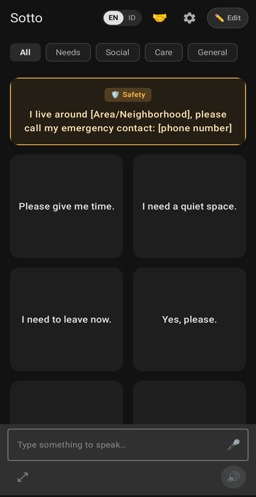

# Sotto

**TL;DR**: Sotto (*"under one's breath"*) is a calm yes/no tool for caregivers to reach autistic teens & adults in meltdowns and verbal shutdowns, paired with a dignified, low-stimulation AAC speech board for self-expression.

<p align="center">
  
</p>

<p align="center">
  🎬 <b>Video Demo:</b> 
  <a href="https://youtu.be/Kd9qPu3F-Gg">YouTube</a>
</p>

---

## Origin & The Dual Mode Truth

> *"Built by a father in Singapore for his two autistic sons (22 & 15) who can speak but not always. During meltdown I operate Sotto on MY phone, they tap Yes/No to pinpoint — issue resolved."*

Sotto was created out of real family experience. When sensory overload strikes, operating a phone, reading complex choices, or processing multi-step menus is impossible.

We use Sotto in two distinct modes:

* **MODE 1 — DAILY (He holds his phone):**  
  Self-operated dignified AAC for complex information, noisy spaces, or unfamiliar people. The individual opens Sotto themselves and taps phrase cards (**Needs**, **Social**, **Care**, **General**) or types in the Quick-Speak Bar. 1-tap speech, long-press for giant fullscreen text.
* **MODE 2 — MELTDOWN (You hold YOUR phone):**  
  Caregiver-operated on the caregiver's device. During acute sensory meltdowns or verbal shutdowns, operating a phone is too difficult. The caregiver opens Sotto, enters Partner Mode, flips the phone 180° (`🔄`) to show giant text, and the individual taps **Yes / No / Wait / Repeat** (or **Not sure / Stop**). Direct binary choice pinpoints the problem without navigating a complex tree.

> **Medical Disclaimer:** Sotto is not a medical device and does not provide medical advice, diagnosis, or treatment. It is an assistive communication tool.

---

## Target Audience
- **Parents, Siblings, Family, Caregivers & Allies**: Reaching loved ones during verbal shutdowns, cognitive freezes, and meltdowns with immediate 1-tap binary check-ins; discovering hidden root causes post-crisis.
- **Autistic Teens & Adults**: Dignified self-advocacy and daily communication with high-contrast, low-stimulation phrase cards and giant fullscreen text.
- **Individuals with Unclear, Fatigued, or Non-Speaking Speech**: Accessible one-touch speech for motor apraxia, dysarthria, cerebral palsy, ALS, stroke recovery (aphasia), quiet/strained voices, or situational speech loss.

---

## Key Features

### 1. Direct Yes/No Crisis Navigation & Post-Crisis Explorer (Caregiver Mode)
- **Two-Way Partner Mode & 180° Flip (`🤝`)**: Immediate crisis support for acute meltdowns and verbal shutdowns. Caregivers speak naturally or pick preset questions, flip the display 180° on a table, and the individual responds with one tap on huge 80dp+ targets (`Yes`, `No`, `Wait`, `Repeat` / `Not sure`, `Stop`) with instant voice confirmation. Zero cognitive load.
- **Why Finder Post-Crisis Explorer (`🧭`)**: When distress triggers are unknown, Why Finder provides a gentle, post-crisis binary discovery tree to systematically uncover hidden physical discomfort (with body map locator), sensory overload, emotional fatigue, or routine disruptions without demanding open-ended answers.
- **Private Pattern Log & 30-Day Trends**: Automatically logs resolved crisis events locally in private app storage. Highlights top 30-day root-cause patterns and peak time-of-day clusters to help families identify recurring environmental stressors.
- **Customizable Inquiry Tree (`🌳`)**: Personalize questions and areas with voice dictation (`🎤`), sequence reordering, and one-tap defaults reset.

### 2. Dignified Self-Expression (AAC Phrase Board)
- **Low-Stimulus UI**: Dark-neutral Material 3 theme with high contrast, calm earth tones, and zero cartoon animations or visual distractions.
- **Zero-Distraction Mode**: Administrative actions (add, edit, delete, reorder) remain hidden during communication.
- **Safety Bystander Card**: Prominent high-contrast card and fullscreen banner for non-verbal episodes, local contacts, and support personnel.
- **Quick-Speak Bar**: Docked bottom bar for spontaneous speech (`🔊`), fullscreen expand, voice dictation (`🎤`), and 1-tap card creation (`+`).
- **Contextual & Custom Categories**: Filter cards by situation (**Safety**, **Needs**, **Social**, **Care**, **General**), or customize your own categories.
- **High-Visibility Fullscreen**: Long-press any card to show giant text for silent, readable communication in loud spaces.
- **Dual-Language & On-Device Translation**: Display cards in one language while speaking in another, with 100% offline ML Kit models.

### 3. Privacy & Offline Guarantee
- **100% Offline Core**: Zero cloud accounts, zero ads, and zero third-party tracking SDKs. Audio, phrases, Why Finder trees, and Why logs stay strictly on-device.
- **Backup & Restore v2**: Full JSON backup with selective checkboxes for phrases, Why tree, and private Why log. Easily export a customized tree to a therapist or teacher without sharing private crisis notes.
- **Optional Usability Telemetry**: Strictly opt-in (default OFF) anonymous interaction telemetry to help diagnose accessibility friction (zero text, audio, or phrase hashes collected).

---

## Installation

### Option 1: Google Play Beta (Closed Testing)
Receive automatic background updates through Google Play:

1. **Join the Testers Group**:  
   Join with the Google account used on your Android device:  
   👉 [**Join Sotto Testers Group**](https://groups.google.com/g/sotto-testers) *(tap "Join group")*
2. **Opt In & Download**:  
   After joining the group, opt in and install via Google Play:  
   👉 [**Join on Android (Play Store)**](https://play.google.com/store/apps/details?id=com.amh.sotto) or [**Join on the Web**](https://play.google.com/apps/testing/com.amh.sotto)
3. Tap **"Become a tester"**, then install Sotto directly from Google Play.

> **Tip**: If Google Play shows *"App not available"*, ensure you are signed into the Play Store with the same Google account that joined the Google Group.

---

### Option 2: Direct APK Download (Offline / Sideload)
For offline devices, deGoogled systems, or quick testing without a Google account:

1. Download the latest `.apk` from [Releases](https://github.com/triton1502oc/Sotto/releases).
2. Open the downloaded file (allow "Install Unknown Apps" if prompted by Android).
3. Tap **Install** and launch Sotto.

### For Developers & Documentation
```bash
./gradlew assembleDebug
```
- **Caregiver & User Guide**: See [docs/CAREGIVER_GUIDE.md](docs/CAREGIVER_GUIDE.md).
- **Language & Localization**: See [docs/LANGUAGE_AND_LOCALIZATION.md](docs/LANGUAGE_AND_LOCALIZATION.md).
- **Device Debugging**: See [docs/RUNNING_ON_DEVICE.md](docs/RUNNING_ON_DEVICE.md).
- **Contributing & Guidelines**: See [CONTRIBUTING.md](CONTRIBUTING.md).

---

## License
Licensed under the [GNU General Public License v3.0](LICENSE) (with Apple App Store Exception).
