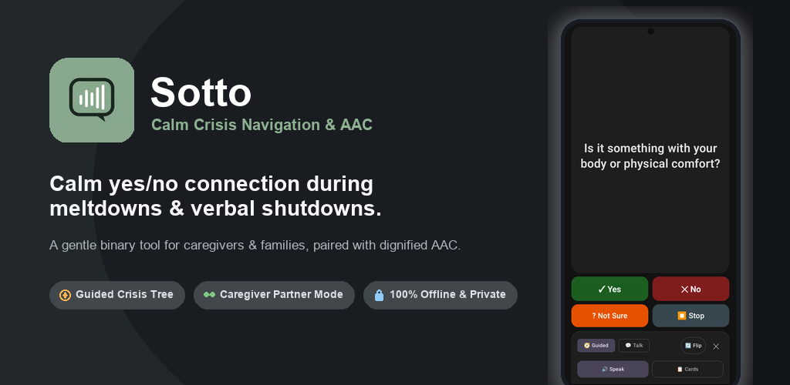

# Sotto

<p align="center">
  
</p>

<p align="center">
  🎬 <b>Video Demo:</b> 
  <a href="https://youtu.be/Kd9qPu3F-Gg">YouTube (Play Store Preview)</a>
</p>

**TL;DR**: Sotto (*"under one's breath"*) is a calm yes/no tool for caregivers to reach autistic teens & adults in meltdowns and verbal shutdowns, paired with a dignified, low-stimulation AAC speech board for self-expression.

Native Android app with 100% offline core, zero cloud accounts, and 1:1 feature parity with [Sotto for iOS](https://github.com/triton1502oc/Sotto-iOS).

---

## Origin & The Dual Mode Truth

> *"Built by a father in Singapore for his two autistic sons (22 & 15) who can speak but not always. During meltdown I operate Sotto on MY phone, they tap Yes/No to pinpoint — issue resolved."*

Sotto was created out of real family experience. When sensory overload strikes, operating a phone, reading complex choices, or processing multi-step menus is impossible.

We use Sotto in two distinct modes:

* **MODE 1 — DAILY (He holds his phone):**  
  Self-operated dignified AAC for complex information, noisy spaces, or unfamiliar people. The individual opens Sotto themselves and taps phrase cards (**Needs**, **Social**, **Care**, **General**) or types in the Quick-Speak Bar. 1-tap speech, long-press for giant fullscreen text.
* **MODE 2 — MELTDOWN (You hold YOUR phone):**  
  Caregiver-operated on the caregiver's device. During acute sensory meltdowns or verbal shutdowns, operating a phone is too difficult. The caregiver opens Sotto, enters Partner Mode, flips the phone 180° to show giant text, and the individual responds via **Yes / No / Wait / Repeat** (or **Not sure / Stop**). Direct binary choice pinpoints the problem without navigating a complex tree.

> **Medical Disclaimer:** Sotto is not a medical device and does not provide medical advice, diagnosis, or treatment. It is an assistive communication tool.

---

## Target Audience
- **Parents, Siblings, Family, Caregivers & Allies**: Reaching loved ones during verbal shutdowns, cognitive freezes, and meltdowns with immediate 1-tap binary check-ins; discovering hidden root causes post-crisis.
- **Autistic Teens & Adults**: Dignified self-advocacy and daily communication with high-contrast, low-stimulation phrase cards and giant fullscreen text.
- **Individuals with Unclear, Fatigued, or Non-Speaking Speech**: Accessible one-touch speech for motor apraxia, dysarthria, cerebral palsy, ALS, stroke recovery (aphasia), quiet/strained voices, or situational speech loss.

---

## Key Features

### 1. Direct Yes/No Crisis Navigation & Post-Crisis Explorer (Caregiver Mode)
- **Two-Way Partner Mode & Animated 180° Flip**: Immediate crisis support for acute meltdowns and verbal shutdowns. Caregivers speak naturally or pick preset questions, flip the display 180° with smooth animated perspective, and the individual responds with one tap on elevated 80dp+ tactile targets (`Yes`, `No`, `Wait`, `Repeat` / `Not sure`, `Stop`) with instant voice confirmation. Zero cognitive load.
- **Sotto Partner Quick Settings Tile**: Direct 1-tap launch into Partner Mode in under 3 seconds from the Android notification shade.
- **Why Finder Post-Crisis Explorer**: When distress triggers are unknown, Why Finder provides a gentle, post-crisis binary discovery tree to systematically uncover hidden physical discomfort (with body map locator), sensory overload, emotional fatigue, or routine disruptions without demanding open-ended answers.
- **Private Pattern Log & 30-Day Trends**: Automatically logs resolved crisis events locally in private app storage with 1-tap post-resolution trigger chips (`Pain`, `Noise`, `Task`, `Emotion`, `Other`). Highlights top 30-day root-cause patterns and peak time-of-day clusters to help families identify recurring environmental stressors.
- **Customizable Inquiry Tree**: Personalize questions and areas with voice dictation, sequence reordering, and one-tap defaults reset.

### 2. Dignified Self-Expression (AAC Phrase Board)
- **Picture-in-Picture (PiP) AAC Communicator**: Low-friction floating AAC mode enabling continuous Yes/No/Wait communication while navigating maps, videos, or external apps.
- **Low-Stimulus UI & Sensory Color Themes**: Curated sensory-friendly color palettes accessible from Settings (Appearance) to accommodate neurodivergent needs, photophobia, and astigmatism halation while upholding WCAG 2.1 AAA contrast: **Charcoal** (default low-stimulus dark neutral), **OLED Pure Black** (maximum contrast and power efficiency), **Warm Amber / Low Strain** (low blue light dark sepia), **Slate Navy** (calm focus), and **Soft Parchment** (anti-halation muted daylight).
- **Zero-Distraction Mode**: Administrative actions (add, edit, delete, reorder) remain hidden during communication.
- **Safety Bystander Card**: Dedicated full-width hero card for non-verbal episodes and shutdowns. Features a distinct Safety badge, digit-by-digit phone number TTS formatting so emergency numbers are read naturally, and a specialized fullscreen view with high-contrast amber styling for bystanders, doctors, or first responders.
- **Single-Row QuickSpeak Dock Capsule**: Streamlined ~56dp single-row dock capsule with inline speech, fullscreen expansion, voice dictation, smart clear toggle, and 1-tap card saving.
- **Compact Card Density & Contextual Categories**: User-configurable compact card layout option (`1.25:1` aspect ratio) saving +25% screen space; filter cards by situation (**Safety**, **Needs**, **Social**, **Care**, **General**), or customize your own categories with fine-motor single-step reordering and safe fallback reassignment upon deletion.
- **Categorized 3-Tab Settings**: Clean Material 3 tabs (Voice & Speech, Appearance & Safety, Data & Backup) with vector iconography replacing legacy emoji headers.
- **High-Visibility Fullscreen**: Long-press any card to show giant text for silent, readable communication in loud spaces.
- **Attention Chime & Haptics**: Built-in two-tone musical chime and haptic vibration alert to capture listener attention before speech begins.
- **Dual-Language & On-Device Translation**: Display cards in one language while speaking in another, with 100% offline ML Kit models.

### 3. Privacy & Offline Guarantee
- **100% Offline Core**: Zero cloud accounts, zero ads, and zero third-party tracking SDKs. Audio, phrases, Why Finder trees, and Why logs stay strictly on-device.
- **Instant Offline QR Code Deck Sharing**: Share and import phrase decks instantaneously offline using high-density QR codes (`SOTTO:v1:...` / compact JSON) and an integrated camera scanner between Android and iOS devices—zero accounts, cloud, or pairing required.
- **Backup & Restore v2**: Full JSON backup with selective checkboxes for phrases, Why tree, and private Why log with merge and replace restore strategies. Easily export a customized tree to a therapist or teacher without sharing private crisis notes.
- **Privacy-Preserving Telemetry & 14-Day PMF Survey (Opt-In)**: Strictly opt-in (default OFF) anonymous interaction telemetry measuring accessibility latency and hesitation to assess product-market fit, complete with category scrubbing (`custom`), payload inspection preview sheet, and a 14-day PMF survey modal (zero text, audio, or phrase hashes collected).

---

## Demo Videos

High-definition demo videos and reproduction scripts showcasing Sotto's assistive communication and crisis navigation features on Android:

- **Google Play Preview (Master)**: [`demo/sotto_google_play_preview.mp4`](demo/sotto_google_play_preview.mp4) (60s, 1920×1080 Landscape, Neural Baritone + Andrew + Ambient Bed + Chime) — [Watch on YouTube](https://youtu.be/Kd9qPu3F-Gg)
- **Shorts / Reels / TikTok (Vertical)**: [`demo/sotto_vertical_preview.mp4`](demo/sotto_vertical_preview.mp4) (60s, 1080×1920 Portrait 9:16)
- **English Device Demo**: [`demo/sotto_demo_en.mp4`](demo/sotto_demo_en.mp4) (~54s, 720×1600 Portrait, Samantha)
- **Indonesian Device Demo**: [`demo/sotto_demo_id.mp4`](demo/sotto_demo_id.mp4) (~54s, 720×1600 Portrait, Damayanti)

For full details on the automated motion generator and reproduction instructions, see [demo/README.md](demo/README.md).

---

## Project Structure

```
Sotto/
├── AGENTS.md                       # Universal AI agent guidelines & flight rules
├── CHANGELOG.md                    # Project release notes & version history
├── CODE_OF_CONDUCT.md              # Contributor Covenant Code of Conduct v2.1
├── CONTRIBUTING.md                 # Design philosophy, architecture, & contribution guide
├── GEMINI.md                       # Local Gemini preferences & workflow rules
├── LICENSE                         # GNU General Public License v3.0
├── PRIVACY_POLICY.md               # Offline privacy policy
├── SECURITY.md                     # Vulnerability disclosure & offline privacy policy
├── app/
│   ├── src/main/java/com/amh/sotto/
│   │   ├── MainActivity.kt         # Single-activity Compose entry point & lifecycle
│   │   ├── data/                   # Data repositories & settings persistence
│   │   │   ├── PhraseRepository.kt # SharedPreferences phrase storage & seed data
│   │   │   ├── VoiceSettingsRepository.kt # TTS pitch, rate, theme & PMF survey state
│   │   │   └── WhyFinderRepository.kt # Crisis inquiry tree & offline session logs
│   │   ├── model/                  # Core domain models
│   │   │   ├── Phrase.kt           # Phrase item, category, & emergency flags
│   │   │   ├── VoiceSettings.kt    # Voice configuration & sensory theme presets
│   │   │   └── WhyFinder.kt        # Question tree, node navigation & crisis log
│   │   ├── service/                # System services
│   │   │   └── EmergencyTileService.kt # Sotto Partner Quick Settings notification shade tile
│   │   ├── ui/
│   │   │   ├── category/           # Category management bottom sheet
│   │   │   ├── conversation/       # Two-Way Partner Mode dialogs & animated 180° flip HUD
│   │   │   ├── main/               # Main phrase board, QuickSpeak capsule, QR dialogs & settings
│   │   │   ├── pip/                # Picture-in-Picture floating quick communicator
│   │   │   ├── theme/              # Material 3 sensory themes (Charcoal, OLED, Amber, Navy, Parchment)
│   │   │   └── whyfinder/          # Why Finder crisis inquiry dialogs & tree editor
│   │   └── util/                   # Offline utilities
│   │       ├── ChimePlayer.kt      # Two-tone musical chime & haptic synthesizer
│   │       ├── LocaleHelper.kt     # Language detection & digit-by-digit phone TTS
│   │       ├── PhraseBackupHelper.kt # JSON v2 backup, restore & optical QR encoder/decoder
│   │       ├── TranslationHelper.kt # ML Kit offline on-device translation
│   │       └── UsabilityTracker.kt # Privacy-preserving opt-in telemetry & PMF survey
│   └── src/test/java/com/amh/sotto/ # Unit test suites for models, backup & detection
├── assets/                         # Visual graphics, screenshots & store icons
├── demo/                           # Synchronized demo videos & recording pipeline
└── docs/                           # Guides, Play Store listing & scenario QR decks
```

---

## Installation

### Option 1: Google Play Beta (Closed Testing)
Receive automatic background updates through Google Play:

1. **Join the Testers Group**:  
   Join with the Google account used on your Android device:  
   👉 [**Join Sotto Testers Group**](https://groups.google.com/g/sotto-testers) *(tap "Join group")*
2. **Opt In & Download**:  
   After joining the group, opt in and install via Google Play:  
   👉 [**Join on Android (Play Store)**](https://play.google.com/store/apps/details?id=com.amh.sotto) or [**Join on the Web**](https://play.google.com/apps/testing/com.amh.sotto)
3. Tap **"Become a tester"**, then install Sotto directly from Google Play.

> **Tip**: If Google Play shows *"App not available"*, ensure you are signed into the Play Store with the same Google account that joined the Google Group.

---

### Option 2: Direct APK Download (Offline / Sideload)
For offline devices, deGoogled systems, or quick testing without a Google account:

1. Download the latest `.apk` from [Releases](https://github.com/triton1502oc/Sotto/releases).
2. Open the downloaded file (allow "Install Unknown Apps" if prompted by Android).
3. Tap **Install** and launch Sotto.

---

## Documentation & Development

```bash
./gradlew assembleDebug
```

- **Caregiver & User Guide**: See [docs/CAREGIVER_GUIDE.md](docs/CAREGIVER_GUIDE.md) for Two-Way Mode, phrase cards, and emergency protocols.
- **Curated Scenario Decks**: See [docs/SCENARIO_DECKS.md](docs/SCENARIO_DECKS.md) for scannable QR codes and printable phrase packs (Medical, Transit, School, Dental).
- **Language & Localization**: See [docs/LANGUAGE_AND_LOCALIZATION.md](docs/LANGUAGE_AND_LOCALIZATION.md) for language models, TTS voice data, and offline translation.
- **Device Debugging**: See [docs/RUNNING_ON_DEVICE.md](docs/RUNNING_ON_DEVICE.md) for physical device testing.
- **Play Store Listing**: See [docs/PLAY_STORE_LISTING.md](docs/PLAY_STORE_LISTING.md) for store metadata and release notes.
- **Contributing & Guidelines**: See [CONTRIBUTING.md](CONTRIBUTING.md) for design philosophy and architectural guardrails.
- **AI Agent Guidelines**: See [AGENTS.md](AGENTS.md) for universal flight rules for AI coding assistants.
- **Changelog & Releases**: See [CHANGELOG.md](CHANGELOG.md) for version history.
- **Companion iOS App**: See [Sotto for iOS](https://github.com/triton1502oc/Sotto-iOS) for the native SwiftUI port.

---

## License
Licensed under the [GNU General Public License v3.0](LICENSE) (with Apple App Store Exception).
