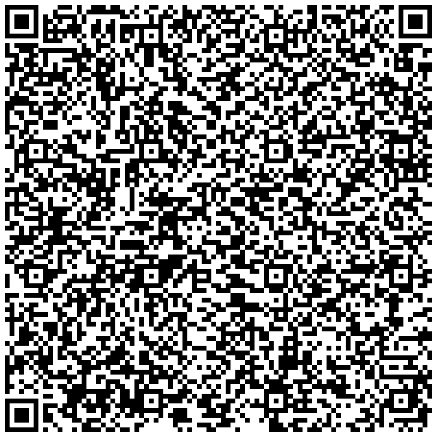
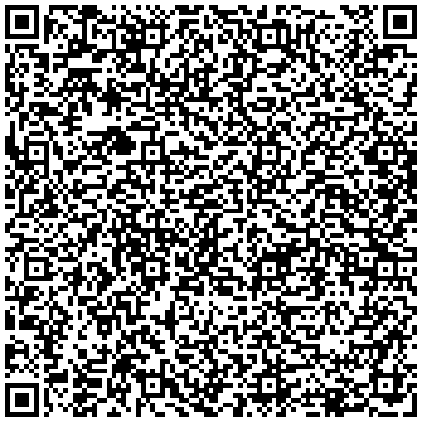
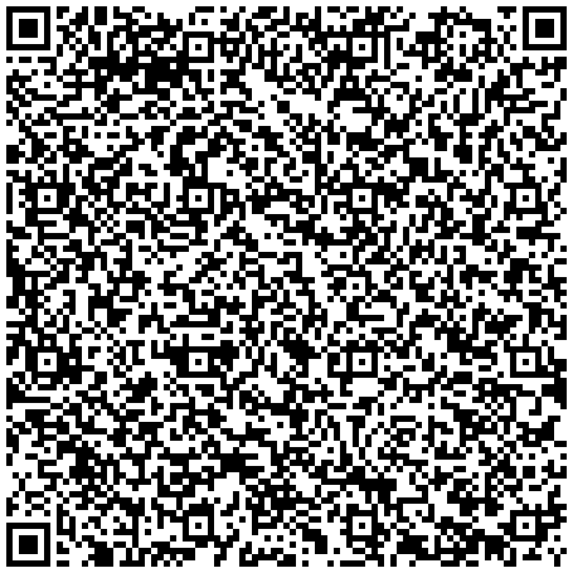
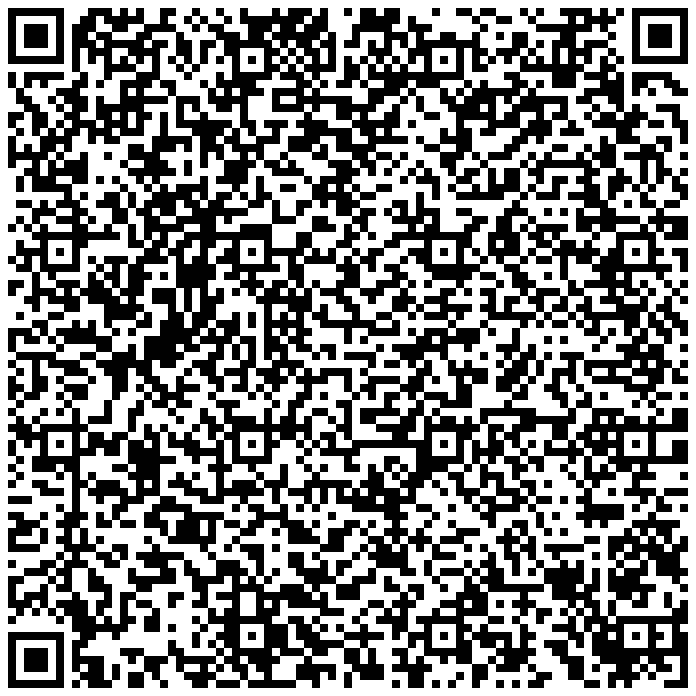

# Curated Situational AAC Decks & Scannable QR Codes

### TL;DR
Ready-to-use, therapist-reviewed phrase packs for high-friction real-world environments (Medical/ER, Transit, School, and Dental care). Scan the QR codes directly using Sotto's built-in offline scanner (top bar `QR` icon) on iOS or Android to import these decks instantaneously with zero typing or cloud setup.

---

## How to Import a Deck

1. Open **Sotto** on your iPhone, iPad, or Android device.
2. In the top bar, tap the **QR Scanner icon** (`📷` / `Scan QR`).
3. Point your camera at any QR code on this page (or a printed copy).
4. Review the incoming phrases and select **Merge** (adds to existing cards) or **Replace** (creates a dedicated scenario board).

---

## 1. 🏥 Medical & Emergency Room Visit

Designed for hospital intake, urgent care, comfort checks, and physical assessments when verbal communication is compromised or painful.

<p align="center">
  
</p>

### Included Phrases:
* 🛡️ **"I have a medical condition and need assistance."** *(Emergency / High Contrast)*
* **"Please do not touch me without telling me first."** *(Sensory & Physical Boundaries)*
* **"The pain is severe (8-10/10)."** *(Pain Scale)*
* **"The pain is moderate (4-7/10)."** *(Pain Scale)*
* **"I am feeling dizzy, lightheaded, or nauseous."** *(Symptom Description)*
* **"Please write down or type what you are saying."** *(Communication Accommodation)*
* **"Please call my emergency contact."** *(Advocacy)*

<details>
<summary>Click to view compact JSON payload</summary>

```json
{"version":2,"categories":["Medical"],"phrases":[{"text":"I have a medical condition and need assistance.","isEmergency":true},{"text":"Please do not touch me without telling me first.","category":"Medical"},{"text":"The pain is severe (8-10/10).","category":"Medical"},{"text":"The pain is moderate (4-7/10).","category":"Medical"},{"text":"I am feeling dizzy, lightheaded, or nauseous.","category":"Medical"},{"text":"Please write down or type what you are saying.","category":"Medical"},{"text":"Please call my emergency contact.","category":"Medical"}]}
```
</details>

---

## 2. ✈️ Transit, Travel & Airport

Designed for high-stimulation transportation hubs (airports, subways, train stations, security checkpoints) where noise, crowding, and visual disorientation trigger sensory meltdowns.

<p align="center">
  
</p>

### Included Phrases:
* 🛡️ **"I am autistic and experiencing sensory overload."** *(Emergency / High Contrast)*
* **"I need to find a quiet space to decompress."** *(Sensory Accommodation)*
* **"Please speak slowly and clearly."** *(Processing Support)*
* **"Can someone guide me to my gate or seat?"** *(Assistance Request)*
* **"I need to sit down right now."** *(Physical Relief)*
* **"Please give me space. Do not crowd me."** *(Boundary Defense)*

<details>
<summary>Click to view compact JSON payload</summary>

```json
{"version":2,"categories":["Transit"],"phrases":[{"text":"I am autistic and experiencing sensory overload.","isEmergency":true},{"text":"I need to find a quiet space to decompress.","category":"Transit"},{"text":"Please speak slowly and clearly.","category":"Transit"},{"text":"Can someone guide me to my gate or seat?","category":"Transit"},{"text":"I need to sit down right now.","category":"Transit"},{"text":"Please give me space. Do not crowd me.","category":"Transit"}]}
```
</details>

---

## 3. 🏫 Classroom & Academic Accommodations

Designed for autistic students, teens, and college adults experiencing situational mutism, exam fatigue, or cognitive overload in educational environments.

<p align="center">
  
</p>

### Included Phrases:
* 🛡️ **"I am having a verbal shutdown. I can hear but cannot speak."** *(Emergency / High Contrast)*
* **"I need a 5-minute quiet sensory break."** *(IEP Accommodation)*
* **"Please allow me to write or type my answer."** *(Alternative Response)*
* **"Could you please rephrase or simplify the instructions?"** *(Comprehension)*
* **"The noise level in the room is overwhelming."** *(Sensory Alert)*
* **"I am ready to rejoin the activity now."** *(Recovery Update)*

<details>
<summary>Click to view compact JSON payload</summary>

```json
{"version":2,"categories":["School"],"phrases":[{"text":"I am having a verbal shutdown. I can hear but cannot speak.","isEmergency":true},{"text":"I need a 5-minute quiet sensory break.","category":"School"},{"text":"Please allow me to write or type my answer.","category":"School"},{"text":"Could you please rephrase or simplify the instructions?","category":"School"},{"text":"The noise level in the room is overwhelming.","category":"School"},{"text":"I am ready to rejoin the activity now.","category":"School"}]}
```
</details>

---

## 4. 🦷 Dental Appointment

Designed for dental exams, procedures, and hygiene cleanings where speech is physically impossible and sensory sensitivities (drills, vibrations, bright lights, suction) run high.

<p align="center">
  
</p>

### Included Phrases:
* 🛡️ **"Please stop or pause what you are doing."** *(Emergency Stop)*
* **"I need suction or a water rinse."** *(Comfort Request)*
* **"That hurts. Please give me a moment."** *(Pain Alert)*
* **"I need a brief pause to swallow and breathe."** *(Pacing Support)*
* **"Please explain the next instrument before using it."** *(Predictability)*
* **"The vibration or sound is too intense."** *(Sensory Alert)*

<details>
<summary>Click to view compact JSON payload</summary>

```json
{"version":2,"categories":["Dental"],"phrases":[{"text":"Please stop or pause what you are doing.","isEmergency":true},{"text":"I need suction or a water rinse.","category":"Dental"},{"text":"That hurts. Please give me a moment.","category":"Dental"},{"text":"I need a brief pause to swallow and breathe.","category":"Dental"},{"text":"Please explain the next instrument before using it.","category":"Dental"},{"text":"The vibration or sound is too intense.","category":"Dental"}]}
```
</details>

---

## 100% Offline & Cross-Platform

* **No Cloud / No Accounts**: Every QR code on this page contains the complete JSON payload encoded directly in the 2D barcode image. No internet connection is ever required to scan, import, or speak.
* **1:1 iOS & Android Compatibility**: Fully compatible with both [Sotto for iOS](https://github.com/triton1502oc/Sotto-iOS) and [Sotto for Android](https://github.com/triton1502oc/Sotto).
